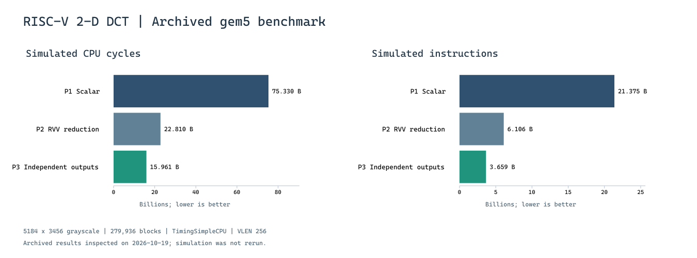

# Computer Architecture Project

Three implementations of an 8 x 8 DCT, quantization and image reconstruction pipeline: scalar C, RVV vector reduction, and RVV parallel accumulation across independent outputs. Performance is studied with archived gem5 simulations, alongside checks of numerical results and reconstructed images.

這個專案比較三種運算映射方式如何影響模擬週期、指令數及數值結果。它涵蓋 DCT、量化、反量化及 IDCT 重建；目前成果範圍不包含完整的 JPEG 位元流編碼與檔案壓縮率評估。

## My contribution

I implemented and analyzed Parts 1–3: the scalar baseline, RVV reduction, and RVV independent-output implementation. Parts 4–5 of the original two-person course project were CUDA implementations contributed by my teammate and are outside the implementation scope of this personal repository.

個人分工已於 2026-10-19 由作者確認。原始團隊提交檔案另外保存；這份個人展示以 Part 1–3 為主。

## What changes between implementations

| Version | Computation mapping | Main implementation detail |
| --- | --- | --- |
| Part 1 | Scalar nested loops | Direct DCT and IDCT accumulation |
| Part 2 | Eight products within a partial dot product | Contiguous RVV loads, vector arithmetic, `vfredusum.vs`, then scalar outer accumulation |
| Part 3 | Eight independent outputs | Each lane accumulates a distinct DCT coefficient or reconstructed pixel; forward DCT uses strided loads of basis values; no vector reduction |

## Archived results

Configuration: gem5 23.1.0.0, TimingSimpleCPU, VLEN 256 bits, ELEN 64 bits, 32 KiB 8-way L1 instruction/data caches, 32-byte cache line. Input: 5184 x 3456 grayscale image, 279,936 blocks; `BLOCKS=0` processes the full image.

| Metric | Scalar | RVV reduction | RVV independent outputs |
| --- | ---: | ---: | ---: |
| Simulated seconds | 37.664831 | 11.404878 | 7.980610 |
| CPU cycles | 75,329,661,396 | 22,809,755,208 | 15,961,219,274 |
| Instructions | 21,374,974,987 | 6,105,866,037 | 3,659,225,278 |
| Baseline cycles / version cycles | 1.00x | 3.30x | 4.72x |
| Baseline instructions / version instructions | 1.00x | 3.50x | 5.84x |
| CPI | 3.524198 | 3.735709 | 4.361907 |

The ratios are computed from saved `stats.txt` files. They describe the recorded simulator configuration and workload; they are not newly measured physical CPU or GPU speedups. No gem5 or CUDA execution was performed during this inspection.

## Numerical results

| Result | Scalar | RVV reduction | RVV independent outputs |
| --- | ---: | ---: | ---: |
| Quantized checksum reported in archived log | 2869008194105992508 | 12560246274068703731 | 2869008194105992508 |
| Nonzero quantized coefficients | 603784 | 603783 | 603784 |
| PSNR reported in archived log | 45.154236 dB | 45.154236 dB | 45.154236 dB |

The saved Part 1 and Part 3 reconstructed PGM files were independently compared on 2026-10-19 and are byte-identical. Their PSNR recalculated from the saved input/output images is 45.154235592 dB, consistent with the rounded log value.

The saved Part 2 reconstructed image differs from Part 1 at 5,826 pixels, despite the same PSNR when rounded to six decimal places. Its quantized checksum also differs. These differences remain visible in the results rather than being described as exact equality. The original team report attributes the numerical changes to floating-point accumulation order; this inspection did not trace individual coefficient differences or rerun the simulator.

Image checks above concern saved artifacts. They do not prove that every intermediate coefficient is bit-identical or establish correctness for every possible input.

## Reproduction plan

This repository preserves the original source and archived results. Reproducing the project requires the following preparation:

1. Correct the old `P1/P2/P3` paths to match the actual `part1/part2/part3` directories, and make input/output and gem5 paths configurable.
2. Preserve archived formal results outside the generated `m5out/` folders, which the current Makefiles delete on run/clean.
3. Provide a small, reproducible sample input and input provenance; keep the full-image benchmark identity and SHA-256 separately.
4. Distinguish a host scalar-fallback smoke test from actual RVV execution in gem5. Host execution does not exercise the RVV assembly.
5. Record the container image digest, compiler version, gem5 revision and commands when a new verification run is performed.

The current assembly requests eight FP32 lanes at LMUL=1 and the archived configuration uses VLEN=256. Portability to other vector lengths is not established.

Full-image benchmark input SHA-256: `a8baf05ce341da86dd0249eaca7a122036ca1cfb584dfbd4194a83396ff153b6`.

## Project context

Originally developed as a two-person Computer Architecture final project. This repository highlights the author's scalar/RVV contribution and retains evidence boundaries between archived logs, saved-image checks and future execution tests.
